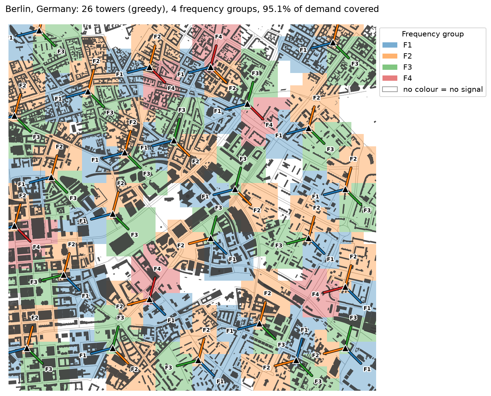
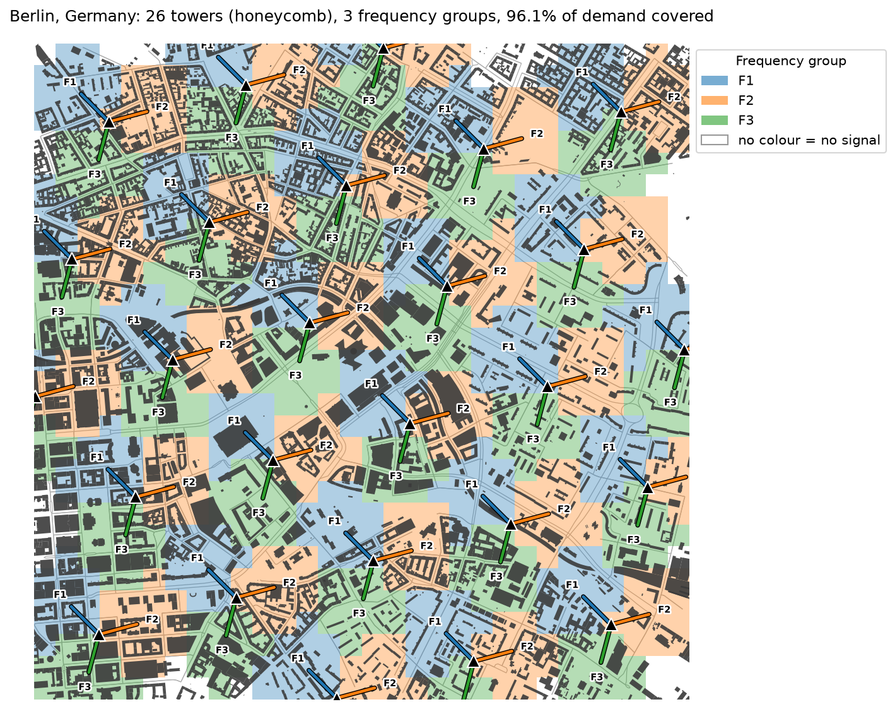
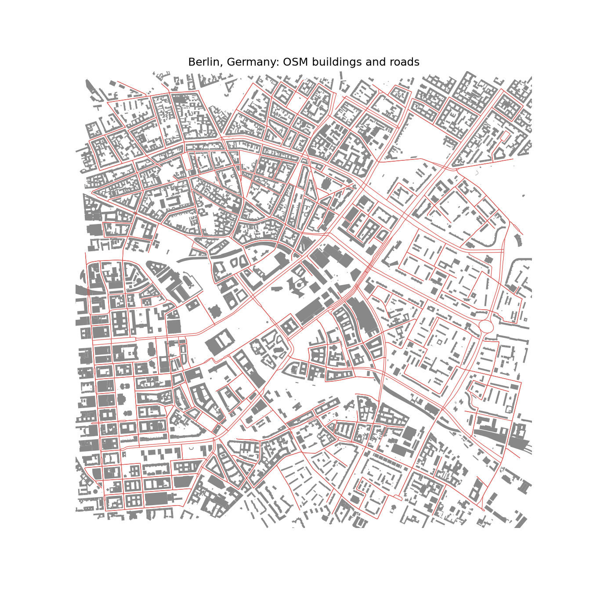
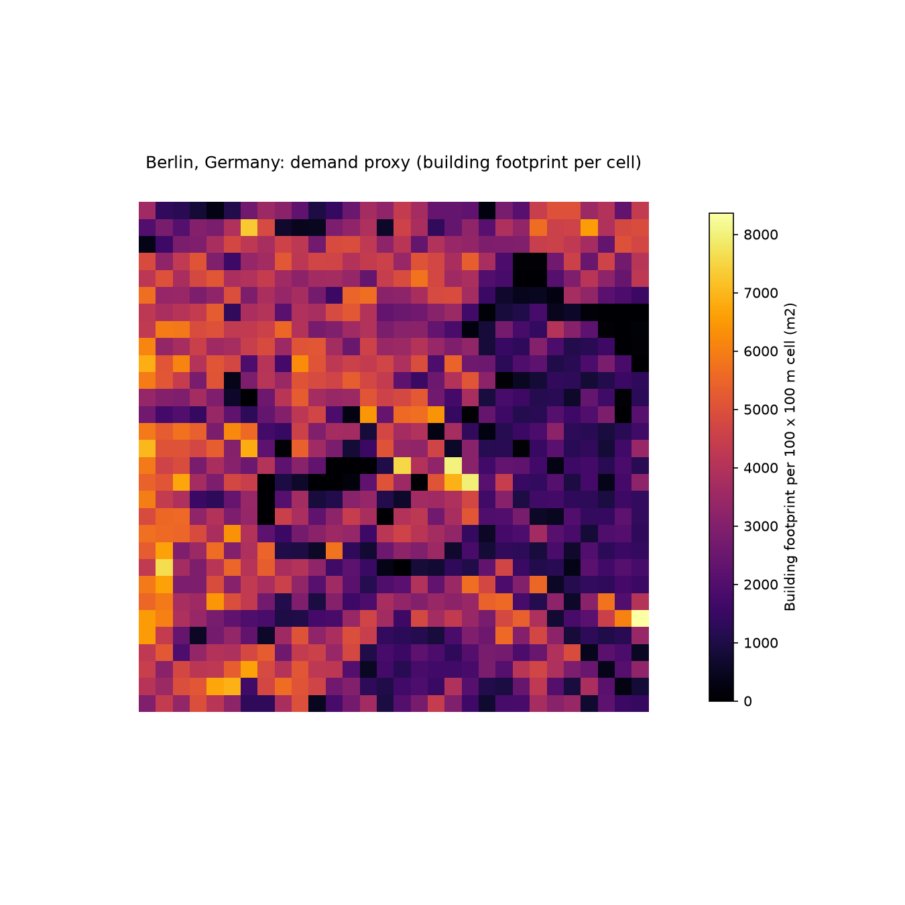
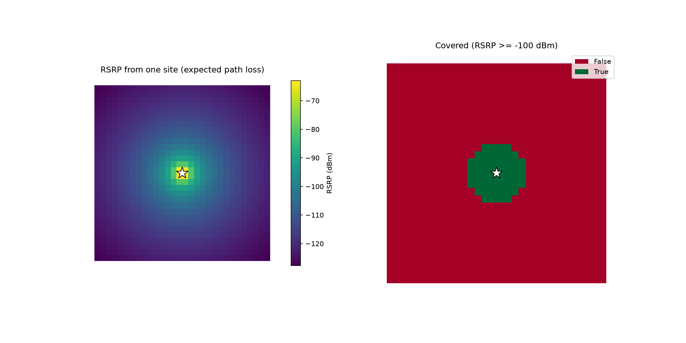
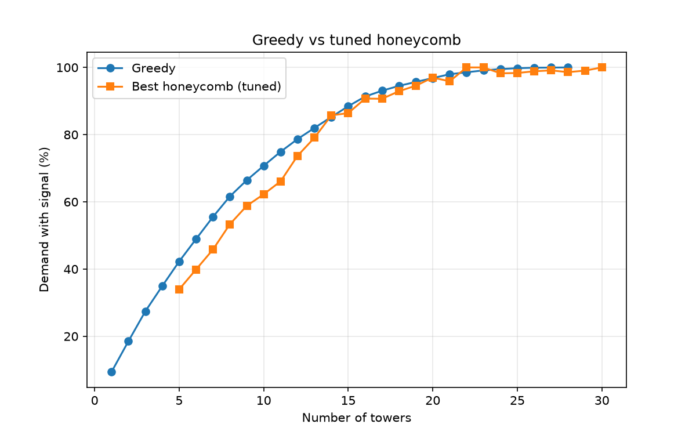
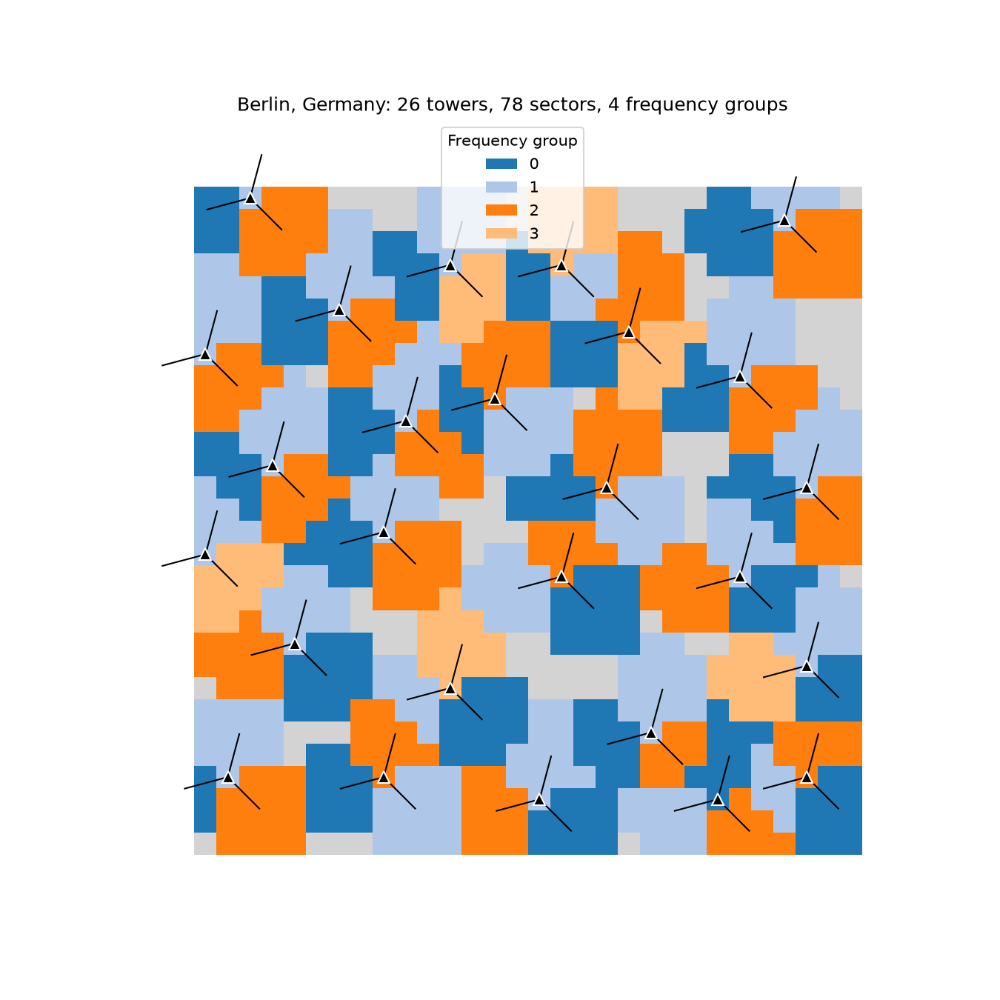
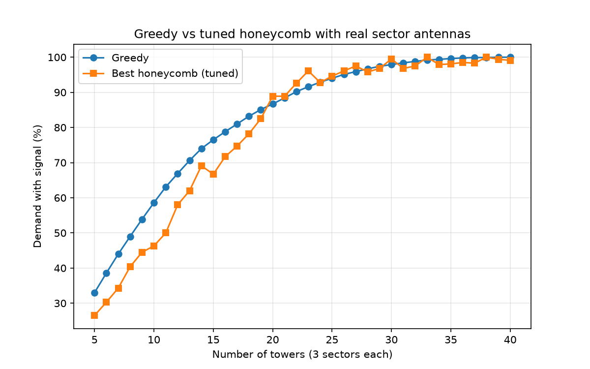

# AI-assisted telecom planning tool

Plan a 5G (3.5 GHz) network for any area: take OpenStreetMap buildings, estimate where demand is,
compute signal strength with a 3GPP propagation model, place base stations, split each into
3 sectors, and assign frequencies with graph colouring.

Case study: a 3 x 3 km area of central Berlin.

| Greedy placement, 26 towers | Tuned honeycomb, 26 towers |
|---|---|
|  |  |

The plan is drawn on top of the real OpenStreetMap buildings and roads. The transparent colour of each square is the frequency group (F1, F2, ...) of the sector that serves it; triangles are towers, coloured lines show where the 3 sectors point, and squares without colour have no signal.

**No machine-learning model is trained in this project, on purpose.** Network planning here is a
physics-and-optimisation problem (propagation model, greedy set cover, graph colouring), so no
training dataset is needed. An LLM agent that calls these tools is planned as a last layer (see
[Status](#status)), and every number it reports will come from the tools, not from the model.

## Status

| Phase | What | Status |
|---|---|---|
| 0 | Scope and assumptions | Done |
| 1 | OpenStreetMap buildings and roads | Done |
| 2 | Demand heatmap | Done |
| 3 | Propagation for one site | Done |
| 4 | Site placement against a hexagonal grid | Done |
| 5 | Sectors and frequency colouring | Done |
| 6 | Evaluation and sensitivity tests | Done |
| 7 | LLM tool-calling agent | Done (tested with the real API on Berlin, Paris and Dokki) |
| 8 | Streamlit app and deployment | App done and tested locally; deployment is next |

## Main results (Berlin, 3 x 3 km, 3.5 GHz)

- One site covers a radius of about 380-400 m: 5.8% of grid cells and 6.2% of demand.
- With real 3-sector antennas, **26 towers (78 sectors)** cover 95% of demand.
- The same 19 towers that looked sufficient with an all-round antenna cover only 79.9% once
  sector patterns are modelled, so the simplified antenna overstated coverage.
- The 78 sectors need **4 frequency groups**, and 4 is the minimum for the conflict graph.
- With a small tower budget greedy placement is much better (up to 13.1 points more demand covered), but at 26 towers a tuned honeycomb covers slightly more: 96.1% of demand against 95.1%.
- The tower count depends strongly on the assumptions (17 to 38 towers in the tests below); the number of frequency groups stays between 3 and 5.

## How it works

### 1. Area selection

Planning is only as good as its input. Before choosing the study area I compared how complete the
OpenStreetMap building data is in two 3 x 3 km candidates:

| Area | Buildings | Footprint (km2) | Median building (m2) | Built-up fraction |
|---|---|---|---|---|
| New Cairo | 1,064 | 0.565 | 366 | 0.063 |
| Berlin | 5,185 | 2.816 | 279 | 0.313 |

New Cairo has complete road data but most building blocks are missing in OSM (confirmed by
comparing with satellite imagery), so a demand map built there would show zero demand over
built-up land. An earlier 3 x 3 km area in Dokki / Mohandessin (Giza) showed visible gaps too.
Berlin is far more complete and became the main case study. The area is a setting (`NAME` and
`CENTER` in the scripts), so the pipeline can be rerun on any location.



### 2. Demand model

The area is cut into 900 grid cells of 100 x 100 m. Each building is split at the cell borders and
the footprint area inside each cell is summed. Building footprint is the demand proxy.



Checks: 16 of 900 cells (1.8%) have no buildings; the maximum in one cell is 8,363 m2 (physical
limit 10,000 m2); the grid total (2.689 km2) is 4.5% below the Phase 1 total (2.816 km2), which is
the part of edge buildings lying outside the study square.

### 3. Propagation

Path loss follows the 3GPP TR 38.901 Urban Macro model at 3.5 GHz: a line-of-sight and a
non-line-of-sight formula, blended by the line-of-sight probability. Signal strength is RSRP (power
per resource element: transmit power spread over 3,276 subcarriers). A cell counts as covered when
RSRP >= -100 dBm. Free-space loss was rejected because it is too optimistic in a city.



### 4. Site placement

Greedy placement adds, one at a time, the tower that covers the most demand that has no signal yet.
It is compared with a regular hexagonal grid. The honeycomb baseline is tuned: spacing, rotation and
position are searched, and the best layout is kept for each tower count.

Phase 4 results, with the simplified all-round antenna (superseded by Phase 5):

| Towers | Greedy: demand | Honeycomb: demand | Greedy: cells | Honeycomb: cells |
|---|---|---|---|---|
| 10 | 70.7% | 62.3% | 58.9% | 61.7% |
| 15 | 88.5% | 86.4% | 81.3% | 85.1% |
| 19 | 95.7% | 94.6% | 92.4% | 94.0% |
| 25 | 99.8% | 98.3% | 99.4% | 98.0% |

Greedy covered more demand at every tower count (8.4 points at 10 towers, about 1 point at 19). The
honeycomb covered more ground at 10-19 towers, because greedy deliberately ignores low-demand areas.



### 5. Sectors and frequency planning

Each tower has 3 sectors 120 degrees apart (3GPP horizontal pattern, 65 degree beamwidth, 30 dB
front-to-back, 15 dBi peak gain). Replanning with real sectors:

| Network | Towers | Demand covered |
|---|---|---|
| Phase 4 towers, all-round antenna (simplified) | 19 | 95.7% |
| Same towers with real sectors | 19 | 79.9% |
| Re-planned with real sectors | 26 | 95.1% |

Frequency assignment is graph colouring. Each sector is a node. Two sectors are connected if they sit
on the same tower, or if one would disturb users served by the other (within 10 dB of the serving
sector, above -110 dBm, in at least 2 grid cells). Four greedy colouring strategies were compared; the
best uses **4 frequency groups** for 78 sectors, and the largest set of mutually conflicting sectors is
also 4, so 4 is the minimum for this graph.



### 6. Evaluation

**Greedy against the tuned honeycomb, both with real sectors.**
The honeycomb gets thousands of layout and rotation tries, greedy only one per antenna rotation, so the
comparison favours the honeycomb.

| Towers | Greedy: demand | Honeycomb: demand | Greedy: cells | Honeycomb: cells |
|---|---|---|---|---|
| 15 | 76.5% | 66.7% | 66.7% | 64.2% |
| 20 | 86.7% | 88.9% | 79.7% | 88.7% |
| 26 | 95.1% | 96.1% | 90.8% | 95.7% |
| 30 | 97.9% | 99.5% | 95.9% | 98.7% |

Greedy covers more demand at 26 of the 36 tower counts tested (5 to 40), with its biggest advantage,
13.1 points, when towers are few. The tuned honeycomb is ahead at 20, 26 and 30 towers (by up to 4.5
points over all counts), including at 26 towers, the size of the Phase 5 plan: 96.1% against 95.1% of
demand and 95.7% against 90.8% of cells. So demand-aware placement matters most with a small tower
budget; at a high coverage target a well-tuned regular layout is as good or better and covers more
ground. Both methods are tuned on the same demand map, there is no separate test area.



**Sensitivity to the assumptions** (one change at a time):

Greedy replanned until 95% of demand is covered. Lower bound = largest set of mutually conflicting sectors.

| Scenario | Towers | Cells covered | Conflicts | Frequency groups (lower bound) |
|---|---|---|---|---|
| Baseline (15 dBi, -100 dBm, 10 dB) | 26 | 90.8% | 175 | 4 (4) |
| Antenna gain 12 dBi | 35 | 90.1% | 232 | 4 (4) |
| Antenna gain 18 dBi | 20 | 91.8% | 146 | 4 (4) |
| Coverage threshold -105 dBm | 17 | 91.4% | 134 | 4 (4) |
| Coverage threshold -95 dBm | 38 | 91.3% | 236 | 4 (3) |
| Conflict margin 6 dB | 26 | 90.8% | 143 | 3 (3) |
| Conflict margin 15 dB | 26 | 90.8% | 207 | 5 (4) |

The tower count is the most assumption-dependent result: 3 dB less antenna gain needs 35 towers instead
of 26 (+35%), 3 dB more needs 20 (-23%), and moving the coverage threshold by 5 dB gives 17 to 38 towers.
The number of frequency groups is steadier (3 to 5, mostly 4) and mainly depends on the conflict margin.
At -95 dBm and at a 15 dB margin the colouring used one group more than the lower bound, so the minimum
is not proven there. Read the tower counts as results under stated assumptions, not as a real network design.

### 7. Planning assistant (LLM agent)

`planner_tools.py` wraps the planning code in seven functions: `area_summary`, `plan_network`,
`towers_needed`, `compare_methods`, `what_if`, `draw_plan` and `change_area`.
`phase7_agent.py` gives them to a Gemini chat model as tools, so a user can ask in plain
language, for example "how many towers for 95% of demand?", "show me the plan with 26 towers"
or "switch to Paris, France", and get an answer with the plan picture.

Design rules: the model must take every number from a tool result and never calculate or remember
one; the agent prints which tools were called; and a rough automatic check warns when the answer
contains a number that was in no tool result of that turn. The model chooses and explains, the
tools do all the calculations.

The tool loop is written out in `phase7_agent.py` instead of using the library's automatic
function calling. Three reasons: every tool that the model asks for is guaranteed to run (the
automatic loop can return the model's last tool request and no text when it runs out of budget),
the number of rounds is capped, and the app can show the tool calls. A repeated call with the same
arguments is answered from the first result instead of running the tool twice.

Any area works: `change_area` looks the name up in OpenStreetMap (it also tries simpler
spellings, district names and coordinates), downloads buildings and roads, and replaces the demand
grid. It refuses an area where buildings cover less than 2% of the square, because that is almost
always open land or missing map data rather than a place to plan, and in that case the previous
area stays. A busy OpenStreetMap server is retried once before the error is reported, and if the
server cannot be reached at all the request stops after about half a minute with a clear message and
the list of saved areas (instead of waiting for the long download timeout; the server is checked
twice because the link to it is sometimes flaky for a moment). The name search is
checked as well: if it only finds a shop, a building or a street, the area is refused and the found
name is shown. This matters because "the capital of the Netherlands" is otherwise sent to a bar
called Capital in Maastricht. Use a city or district name, or coordinates.

### 8. Web app

`app.py` puts the planner and the agent on one page: choose an area (a name such as
`Paris, France` or coordinates such as `48.8566, 2.3522`, with a side between 1 and 5 km), press
**Plan and draw**, and get the plan picture with the numbers next to it (demand covered, squares
covered, towers and sectors, frequency groups, conflicts). A checkbox also compares greedy placement
with the tuned honeycomb at the same tower count. Under the plan there is the chat box, with a list
of the tools the assistant used, so every number can be traced back to a calculation.

The area is loaded once and kept in memory, so moving the sliders and planning again takes seconds.
An area downloaded from OpenStreetMap is also saved in `areas/`, so the next start is instant.
Changing the area (from the sidebar or by asking the assistant, for example "switch to Paris,
France") clears the old plan, the old comparison and the old chat.

Saved areas can also be opened from the sidebar without any download (**Saved areas**), which is
the way to work when the public OpenStreetMap server is down. A name written a little differently
is matched to the saved copy — "Mohandseen, Giza, Egypt" opens the saved "Mohandseen, Dokki, Giza,
Egypt" — but only when the first word is the same, so "Giza, Egypt" does not silently become
Mohandseen.

```powershell
streamlit run app.py
```

It opens at `http://localhost:8501`; stop it with Ctrl+C. `.streamlit/config.toml` hides the
developer menu so the page looks like a finished app; set `toolbarMode = "developer"` while
working on the code.

## Assumptions

| Item | Value |
|---|---|
| Band, bandwidth | 3.5 GHz (n78), 100 MHz, 30 kHz spacing, 3,276 subcarriers |
| Base station / device height | 25 m / 1.5 m |
| Transmit power | 46 dBm per sector |
| Antenna | 15 dBi peak gain, 3GPP horizontal pattern, no vertical pattern or downtilt |
| Coverage rule | RSRP >= -100 dBm |
| Candidate tower sites | Centres of the 100 m grid cells |
| Demand | Building footprint area per cell |

All radio values are assumed generic urban numbers and have not been verified against operator data.

## Limitations

- Building footprint is only a proxy for demand: it ignores height (floors), land use and real traffic.
- Buildings missing from OpenStreetMap look like zero demand (sparse data is treated as low demand).
- No shadow fading, terrain, building heights or indoor loss; the LOS/NLOS split is statistical.
- The path-loss formulas were implemented from TR 38.901 and have not been validated against measurements.
- The frequency conflict rule is a heuristic (margin and thresholds), not an SINR calculation, and the
  number of groups depends on its thresholds (see the sensitivity table).
- Each frequency group is treated as a full 100 MHz carrier, which would need about 400 MHz in total.
  That is more than a typical operator holds at 3.5 GHz. Splitting one carrier into 4 groups would
  change the link budget.
- Phase 4 compared greedy and the honeycomb with an all-round antenna; Phase 6 repeats it with sectors.
- One study area, one run, 100 m resolution; small differences between methods should not be oversold.

## Run it

Python 3.11 or newer.

```powershell
python -m venv .venv
.venv\Scripts\Activate.ps1
python -m pip install osmnx geopandas matplotlib networkx pandas google-genai python-dotenv contextily streamlit requests
python -m pip install -r requirements.txt     # optional: the exact versions that were tested
py phase1_osm.py
py phase2_demand.py
py phase3_propagation.py
py phase4_placement.py
py phase5_sectors.py
py phase6_evaluation.py
py planner_tools.py
py phase7_agent.py
streamlit run app.py          # the web app, opens in the browser at http://localhost:8501
```

The agent needs `GEMINI_API_KEY` in a `.env` file in the project folder (`GEMINI_API_KEY=...`,
never committed), and optionally `GEMINI_MODEL` to choose the model. `py agent_probe.py "your
question"` asks one question from the command line and prints the tool calls, which is the quickest
way to debug the agent.

`planner_tools.py` runs a self-test without any LLM and draws the two plan pictures.
`test_agent_loop.py` tests the agent's tool loop offline: it pretends the model never stops asking
for tools, and checks that the loop still ends with a written answer. `test_app.py` starts the web
app without a browser or an API call, presses **Plan and draw** and checks the numbers against the
README.

Note for Windows: the `py` launcher only uses the virtual environment while it is activated.
In a fresh terminal `py` starts the system Python, which usually has none of the libraries, so
activate `.venv` first or run `.venv\Scripts\python.exe <script>`. A quick check is
`py -c "import sys; print(sys.executable)"`: the path should contain `.venv`.

The plan picture uses the saved OpenStreetMap buildings and roads as its background. Street-map
tiles are only used when a `CARTO_API_KEY` is set, because the public OpenStreetMap tile server
blocks this kind of automatic request and CARTO now needs a free key.

Generated files go to `data/`, `areas/` and `plans/` (not committed). Pictures used in this README
are copied to `images/`.

## Next steps

- Read a map picture uploaded by the user (buildings by colour, width in km), and check it against
  the OpenStreetMap grid on Berlin.
- Compare planned sites with real tower locations (for example OpenCelliD) and calibrate the path loss if
  measurements are available.
- Detect buildings from satellite images for areas where OpenStreetMap data is poor.
- Check the possibility of migrating to Mapy API instead of OpenStreetMap